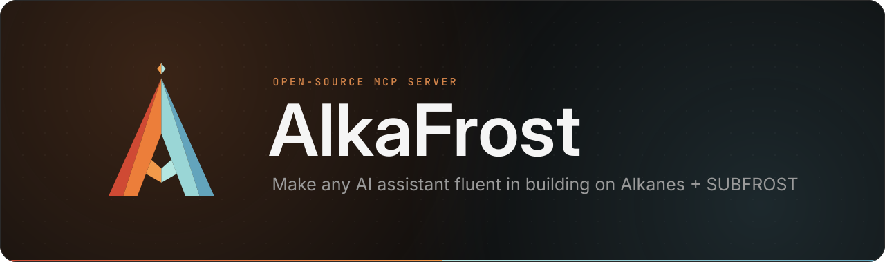
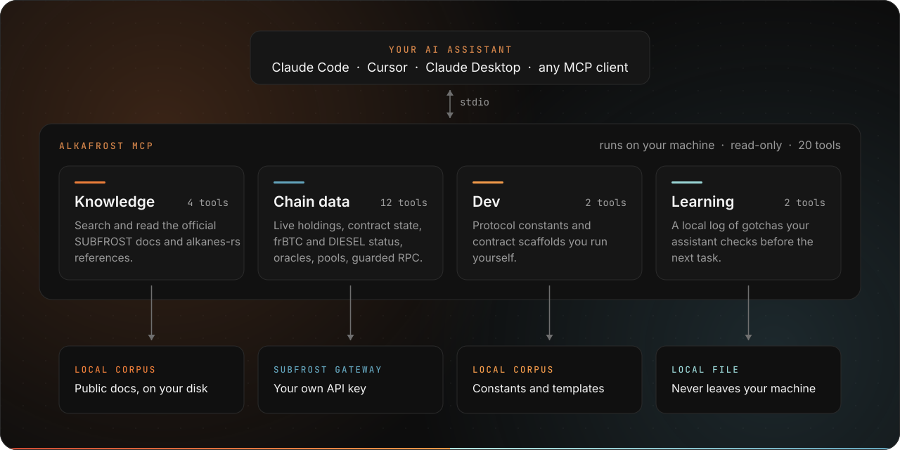

<p align="center">
  
</p>

<p align="center">
  <a href="https://github.com/Aries-Labs-HQ/AlkaFrost-AI-MCP/actions/workflows/ci.yml"></a>
  <a href="LICENSE"></a>
  <a href="https://modelcontextprotocol.io"></a>
  <a href="https://nodejs.org"></a>
  <a href="CONTRIBUTING.md"></a>
</p>

<p align="center">
  <a href="#quickstart"><b>Quickstart</b></a> ·
  <a href="#tools"><b>Tools</b></a> ·
  <a href="#safety"><b>Safety</b></a> ·
  <a href="#configuration"><b>Configuration</b></a> ·
  <a href="#contributing"><b>Contributing</b></a>
</p>

<br>

**AlkaFrost** is a free, open-source [Model Context Protocol](https://modelcontextprotocol.io)
server that gives any MCP-capable assistant — Claude Code, Claude Desktop, Cursor
and others — a working knowledge of the **Alkanes** metaprotocol and the
**SUBFROST** network, plus live read-only chain data.

Point your assistant at it and it can read the official docs, query the chain
and scaffold contracts without leaving your editor. It runs entirely on your
machine with **your own SUBFROST API key**. No account with us, no middleman, no
hosted dependency.

<table>
  <tr>
    <td width="33%" valign="top"><b>20 tools</b><br>Docs, live chain data, contract scaffolds and a local learning log.</td>
    <td width="33%" valign="top"><b>119-doc corpus</b><br>Built from the official, public SUBFROST docs and alkanes-rs. Every file cites its source.</td>
    <td width="33%" valign="top"><b>Read-only by design</b><br>It never signs, never broadcasts and never touches your keys.</td>
  </tr>
</table>

## Quickstart

**You need:** [Node.js](https://nodejs.org) 20 or newer, and a SUBFROST API key
for the live chain tools. The docs and dev tools work without a key.

### 1. Get a SUBFROST API key

AlkaFrost talks to the SUBFROST gateway with your own key.

> **[Sign up for a SUBFROST API key](https://api.subfrost.io/auth/signup?ref=73084DAD)** —
> this link gives you 50% off your first month. We earn nothing from it.

### 2. Install

```bash
git clone https://github.com/Aries-Labs-HQ/AlkaFrost-AI-MCP.git
cd AlkaFrost-AI-MCP
npm install
npm run build
```

### 3. Connect your MCP client

**Claude Code**

```bash
claude mcp add --scope local --transport stdio alkafrost \
  -e SUBFROST_API_KEY=YOUR_KEY \
  -- node /absolute/path/to/AlkaFrost-AI-MCP/dist/index.js
```

Check it with `claude mcp list`, then `/mcp` inside a session. Keep
`-e KEY=value` after the server name and directly before the `--`: the flag
takes several values, so a server name placed straight after it is read as one
more value and rejected.

**Cursor, Claude Desktop, or any client that takes a JSON server config**

```json
{
  "mcpServers": {
    "alkafrost": {
      "command": "node",
      "args": ["/absolute/path/to/AlkaFrost-AI-MCP/dist/index.js"],
      "env": { "SUBFROST_API_KEY": "your-key-here" }
    }
  }
}
```

Your key is sent only as the `x-subfrost-api-key` header to the SUBFROST
gateway — never in a URL, never anywhere else. The server reads it from its
environment, so set it in your client's config as above; it does not load a
`.env` file. `.env.example` lists every variable it reads.

### 4. Ask something

> *"Is the frBTC peg live, who is the signer, and how much frBTC exists?"*
>
> *"What Alkanes tokens does `bc1p…` hold?"*
>
> *"Show the AMM pools and one pool's reserves."*
>
> *"Which JSON-RPC method returns an alkane's bytecode, and what are the rate limits on my plan?"*
>
> *"Scaffold an Orbital NFT contract."*

## How it works

<p align="center">
  
</p>

Your assistant starts AlkaFrost as a local process and talks to it over stdio.
The knowledge and dev tools read a corpus that ships in this repository. The
chain tools call the SUBFROST gateway with the key you supplied. The learning
tools read and write one file on your disk.

## Tools

Twenty tools in four layers. Every tool name starts with `alkafrost_`.

#### Knowledge

Search and read the official SUBFROST docs (protocol, tokens, build guides,
JSON-RPC, REST and CLI reference, platform limits), the alkanes-rs README and
the Orbital reference contract.

| Tool | What it does |
| --- | --- |
| `alkafrost_search` | Searches the corpus and returns the path, heading and a preview for each hit. |
| `alkafrost_doc` | Reads a doc economically: its list of headings, or the body of one section. |
| `alkafrost_full_doc` | Returns the complete markdown of one doc. |
| `alkafrost_catalog` | Lists every doc in the corpus, grouped by section. |

#### Chain data

Live, read-only queries against the SUBFROST gateway with your key.

| Tool | What it does |
| --- | --- |
| `alkafrost_tokens_by_address` | Lists the Alkanes tokens a Bitcoin address holds, outpoint by outpoint. |
| `alkafrost_token` | Reads any alkane's name, symbol, decimals and total supply through opcode views, and flags supply-1 tokens as likely Orbitals. |
| `alkafrost_contract_meta` | Reads a contract's metadata through the `alkanes_meta` view, for contracts that implement it. |
| `alkafrost_bytecode` | Fetches a contract's raw WASM bytecode as hex. |
| `alkafrost_simulate` | Simulates a view call to read contract state without broadcasting anything. |
| `alkafrost_frbtc_status` | Returns frBTC's name, symbol, decimals, total supply and current signer in one call. |
| `alkafrost_diesel_status` | Returns DIESEL's name, symbol, decimals and total supply in one call. |
| `alkafrost_oracle_read` | Reads a value from an oracle contract and decodes it as hex, an integer, text, a boolean or a price. |
| `alkafrost_oracle_price` | Reads the latest price from a price-feed oracle, with the block it was set at and its age. |
| `alkafrost_pools` | Lists the AMM pools of a factory with reserves, TVL and 24-hour volume. |
| `alkafrost_pool_info` | Returns one pool's reserves, token pair and price. |
| `alkafrost_rpc` | Calls a read-only gateway method directly. Write and broadcast methods are blocked. |

#### Dev

| Tool | What it does |
| --- | --- |
| `alkafrost_constants` | Returns the key Alkanes and frBTC constants: contract id, wrap, unwrap and signer opcodes, genesis block, protocol tag. |
| `alkafrost_scaffold` | Returns a starting template: `wrap`, `unwrap`, `contract` or `orbital`. Templates are a starting point, not audited code. |

#### Learning

A local incident log. Your assistant records the pitfalls it hits and checks
them before the next task. The log is a file on your machine and is never sent
anywhere.

| Tool | What it does |
| --- | --- |
| `alkafrost_incident_report` | Records a pitfall with its root cause and its fix. |
| `alkafrost_incident_query` | Looks the log up before work starts: recent entries, a search, counts, or one entry by id. |

## Safety

AlkaFrost is analytics only. It never signs, broadcasts, or touches wallets or
keys.

- **The RPC passthrough is allowlisted.** `alkafrost_rpc` accepts read methods
  only and refuses broadcast, spend and admin calls.
- **You run what it scaffolds.** Templates and constants are handed to you to
  run in your own `alkanes-cli`, where you hold the keys.
- **The incident log stays local.** It writes to your machine only, and a
  best-effort scrub removes secrets, keys and local paths from every report
  before it is saved.
- **Your API key goes one place.** It travels as a request header to the
  SUBFROST gateway and nowhere else.

Found a way around any of that? See [SECURITY.md](SECURITY.md).

## Configuration

| Variable | Purpose |
| --- | --- |
| `SUBFROST_API_KEY` | Required for the chain-data tools. The docs and dev tools work without it. |
| `SUBFROST_RPC` / `SUBFROST_REST` | Optional gateway overrides. The default is mainnet JSON-RPC; the REST address is derived from it. |
| `ALKAFROST_INCIDENTS_PATH` | Optional path for your local incident log. The default is `data/incidents.jsonl`, which is gitignored. |

Logs go to **stderr** only, because stdout is the MCP protocol channel. The doc
index is built from `corpus/` at startup.

| Command | What it does |
| --- | --- |
| `npm run ingest` | Re-pulls the corpus from the official sources. |
| `npm run incidents` | Lists your local incident log. `npm run incidents -- show <id>` prints one entry as markdown, ready to become an issue or a corpus PR. |

## Keeping the docs current

The corpus is generated from **public, official sources only**:

- **[docs.subfrost.io](https://docs.subfrost.io)** — every page listed in the
  site's `llms.txt` and sitemap, taken from its published markdown (converted
  from the page's HTML where it has none).
- **[alkanes-rs](https://github.com/kungfuflex/alkanes-rs)** — the README and the
  `alkanes-std-orbital` reference contract.
- **`corpus/reference/`** — short hand-written references (constants, Orbitals,
  transaction context, scaffolds), each citing a public source.

Run `npm run ingest` to refresh, then restart your MCP client. Every corpus file
carries a `source_url` in its frontmatter, so you can always check the original.

## Good to know

- Alkane ids are written `{block, tx}` or `block:tx`. frBTC is `32:0` and DIESEL,
  the genesis token, is `2:0`. The protocol tag is always `1`.
- To read contract state with `alkafrost_simulate`, put the opcode in `inputs`
  (for example `[103]`), not in `data`.
- **Orbitals** — Alkanes NFTs — are a token with a total supply of 1 and opcode
  `1000` for media. Read one with `alkafrost_oracle_read` and scaffold one with
  `alkafrost_scaffold orbital`.

<details>
<summary><b>Upgrading from a clone made before the AlkaFrost rename</b></summary>

<br>

Tool names now start with `alkafrost_`, and the tutorials tool was removed
together with the third-party tutorial docs. Point your remote at the new
address, pull, rebuild, and add the server again under its new name:

```bash
git remote set-url origin https://github.com/Aries-Labs-HQ/AlkaFrost-AI-MCP.git
git pull
npm install && npm run build
```

</details>

## Contributing

Contributions are welcome. The project gets better the more builders use it.

- **Docs** — fix or add corpus content from a public source.
- **Ingest sources** — point `scripts/ingest.ts` at more official, public docs.
- **Code and tools** — bug fixes, new read-only tools, better scaffolds.
- **Bug reports** — [open an issue](https://github.com/Aries-Labs-HQ/AlkaFrost-AI-MCP/issues/new/choose).

Learned a general Alkanes or SUBFROST gotcha through your local incident log?
That makes a great pull request. The ground rules are in
[CONTRIBUTING.md](CONTRIBUTING.md). Every change lands through a reviewed pull
request.

## Community

Questions, ideas, or something to show: join the
**[Alkane Builder Onboarding group on Telegram](https://t.me/+fgnukd96aCZjZGI5)**,
or open a [GitHub issue](https://github.com/Aries-Labs-HQ/AlkaFrost-AI-MCP/issues).

| | |
| --- | --- |
| SUBFROST API keys | [api.subfrost.io](https://api.subfrost.io/auth/signup?ref=73084DAD) — 50% off your first month; we earn nothing from it |
| SUBFROST docs | [docs.subfrost.io](https://docs.subfrost.io) |
| alkanes-rs | [github.com/kungfuflex/alkanes-rs](https://github.com/kungfuflex/alkanes-rs) |
| Builder kit | [alkanes.dev](https://alkanes.dev) |
| Model Context Protocol | [modelcontextprotocol.io](https://modelcontextprotocol.io) |

## Support the project

AlkaFrost is free and MIT-licensed. The best support is a contribution: a corpus
fix, a new read-only tool, or a good bug report. If you would rather send BTC:

```
bc1qlq5mccc25823m0yk840l7rtd9srgr0mlc7l6xa
```

## License

[MIT](LICENSE) © AlkaFrost MCP contributors.

<p align="center">
  <sub>Built by <a href="https://arieslabs.org">Aries Labs</a>. Aries Labs did not create Alkanes or SUBFROST. We build on them.</sub>
</p>
